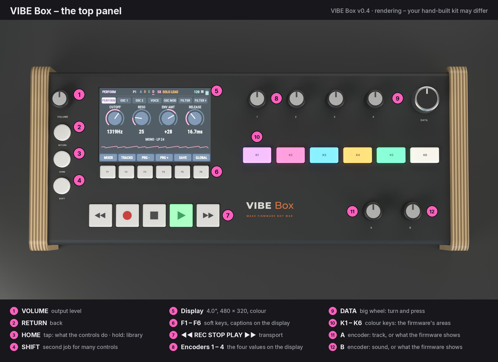
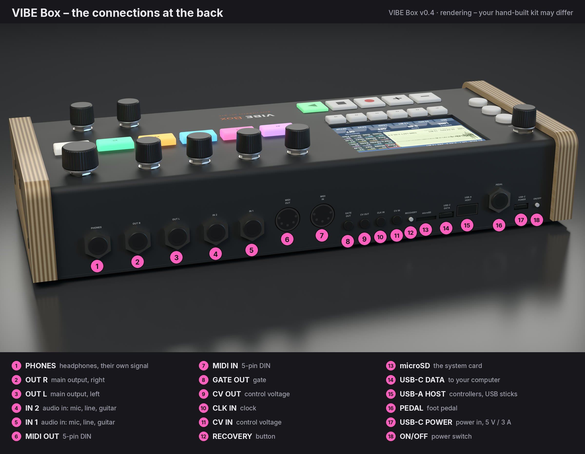

# HARDWARE.md – the VIBE Box

The VIBE Box is the hardware a Vibe runs on natively, the same `.wasm` as in your DAW and in the browser. These are
renderings of the **v0.4 prototype**. The kits are hand-built, so boards, case and buttons may differ. What stays the
same is how your firmware sees each control: the names below are the ones in `sdk/include/vibe.h`.

## The top panel

**Every control is yours.** The names on the panel are the house style, not a rule: each button and encoder reaches
your firmware as a plain event (`VIBE_EV_BUTTON` / `VIBE_EV_ENCODER` with its id), and what it does is up to you. REC
can be a fill, K1 – K6 can be scenes, mutes or drum hits, the transport can step through presets, DATA can scrub a
sample. Only a few things belong to the host, so you can always get out of any firmware:

- **HOME held 1 s, or SHIFT + HOME:** the firmware library (a short tap on HOME is yours).
- **SHIFT + K1 – K6 and SHIFT + RETURN:** the PLAY KEYS (the VIBE's key and scale), until your firmware says
  `vibe_play_keys(0)` – then SHIFT + K is yours too.
- **VOLUME:** the device's own level, no event at all.

How a Vibe should use them – the start page, A track / B sound / DATA pattern, the sequencer on K6, everything without pads: [UI-GUIDE.md](UI-GUIDE.md). What the labels promise is a convention that makes Vibes feel alike – follow it where it fits, drop it where your
instrument wants something else, and say so on your screen (F1 – F6 captions, HOME's control overview).

| # | On the panel | In your code |
|---|---|---|
| 1 | VOLUME | the device's output level – the host's, not an event |
| 2 | RETURN | `VB_RETURN` |
| 3 | HOME | `VB_HOME` (tapped: show what every control does on this page). Held 1 s, or SHIFT + HOME: the host opens the firmware library – never your firmware |
| 4 | SHIFT | `VB_SHIFT` – a second job for many controls |
| 5 | Display | 4.0", 480 × 320, colour, **a touch screen**: `VIBE_SCREEN_W` × `VIBE_SCREEN_H`, drawn in `vibe_on_draw`. A tap or drag comes as `VIBE_EV_TOUCH` (x, y in display pixels); the soft keys and the four value columns work by themselves – [Touch](README.md#touch-one-display-every-host) |
| 6 | F1 – F6 | `VB_F1` … `VB_F6` – soft keys right under the screen, their captions are yours to draw |
| 7 | − + REC STOP PLAY | `VB_OCT_DOWN` (−), `VB_OCT_UP` (+), `VB_REC`, `VB_STOP`, `VB_PLAY` – − / + are the octave keys, as OCT − / OCT + on the VIBE FM |
| 8 | Encoders 1 – 4 | `VE_1` … `VE_4` (`VIBE_EV_ENCODER`, value = detents, + clockwise) – the four values on the screen |
| 9 | DATA | `VE_DATA` to turn, `VB_DATA_PUSH` to press |
| 10 | K1 – K6 | `VB_K1` … `VB_K6` – the colour keys, the firmware's areas (house style SOUND · ENV · LFO · ARP · FX · SEQ) |
| 11 | A | `VE_A` – the track, or whatever the firmware shows for it |
| 12 | B | `VE_B` – the sound, or whatever the firmware shows for it |

All encoders are endless, with no LED rings: values belong on the display. (Say where each one stands with
`vibe_led_ring` – a remote that draws the knobs, as the VIBE's iPad page, turns them along.) Buttons come as `VIBE_EV_BUTTON` with
`e->down` 1 / 0.

**Not on the Box:** the VIBE FM's 25 keys, 16 pads, ENTER and ◀ MENU ▶ (`VB_LEFT`, `VB_MENU`, `VB_RIGHT`: a controller can still send them).
Notes reach the Box over MIDI (the DIN socket, USB-C DATA, or a controller on USB-A HOST). With `vibe_notes(VIBE_NOTES)`
your firmware gets them as `VIBE_EV_NOTE` from every source, so a firmware written for the keys plays on the Box as it is.

## The connections at the back

| # | On the panel | In your code |
|---|---|---|
| 1 | PHONES | OUT L/R, or a signal of its own: `vibe_outputs(VIBE_OUT_CUE)` and `vibe_cue(0 / 1)` |
| 2 – 3 | OUT R, OUT L | the stereo pair you fill in `vibe_on_audio` (`vibe_outputs(VIBE_OUT_DUAL_MONO)`: two mono signals) |
| 4 – 5 | IN 2, IN 1 | `vibe_input(1 / 0)` inside `vibe_on_audio`; `vibe_input_mode`: line, mic or guitar (Hi-Z); `vibe_input_link(1)`: one stereo input |
| 6 – 7 | MIDI OUT, MIDI IN | 5-pin DIN: `vibe_midi_send` out; in comes as `VIBE_EV_MIDI` (notes as `VIBE_EV_NOTE` after `vibe_notes`). The host passes nothing through – your firmware decides |
| 8 | GATE OUT | `vibe_gate_out(on)`, 0 V / +5 V, 3.5 mm |
| 9 | CV OUT | `vibe_cv_out(volts)`, 0 … +5 V, 1 V/oct, 3.5 mm |
| 10 | CLK IN | `VIBE_EV_CLOCK`, one event a pulse, value = seconds since the last one, 3.5 mm |
| 11 | CV IN | `vibe_cv_in()`, −5 … +5 V, 3.5 mm |
| 12 | RECOVERY | button – for the system, not your firmware |
| 13 | microSD | the system card; your firmware's files (`vibe_store_*`) live there |
| 14 | USB-C DATA | to your computer |
| 15 | USB-A HOST | MIDI controllers and USB sticks (`vibe_media_sources` sees the stick) |
| 16 | PEDAL | 6.3 mm TRS, detected by itself: `VIBE_EV_PEDAL`, `VIBE_PEDAL_SWITCH` (down 1 / 0) or `VIBE_PEDAL_EXPR` (0 … 1) |
| 17 | USB-C POWER | power in, 5 V / 3 A |
| 18 | ON/OFF | power switch |

A firmware that does not use an input simply never hears from it. A firmware that uses one runs everywhere else too:
in VIBE FM VST and in the browser the same calls reach the DAW's or the computer's audio and MIDI. See `MANUAL.md` for
how each host stands in for the jacks.
