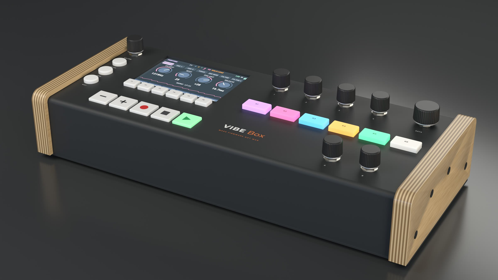
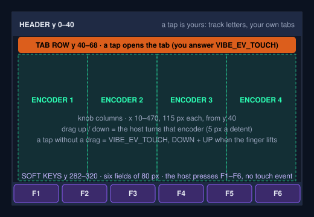

# VIBE FM SDK

**Write a Vibe – or port your FM-1 firmware – in plain C, as one file. It runs in your DAW as a plugin, in the browser,
as a standalone app (iOS coming), and natively on the VIBE FM hardware.**



*The VIBE Box v0.4 – a rendering of the hardware a Vibe runs on natively. Every control and jack with its name in your code: [HARDWARE.md](HARDWARE.md).*

You write a synth (or a sampler, a sequencer, an effect…) in plain C against one small API. It compiles to a single
WebAssembly file. That one `.wasm` runs as a **VST3 / AU / CLAP plugin** in your DAW through VIBE FM VST, in the
**browser**, and on the coming **VIBE FM hardware**. No plugin framework, no GUI toolkit, no per-platform builds.

### What you build – and what you don't

- **You build the instrument:** its sound, its screen, its parameters and its Editor layout. All of it is in your C
  code and your `firmware.json`. The plugin's Editor view is drawn from what your firmware declares (`vibe_params`,
  `vibe_param_groups`, `vibe_editor`), so it is yours too, without a line of GUI code.
- **You don't build a plugin.** VIBE FM VST is the host that makes your `.wasm` a VST3 / AU / CLAP plugin. You don't
  build it, change it, patch it or ship it. It is closed software (all rights reserved). The emulator in `emulator/` is
  a host as well: free for developing, not to pass on or to ship changed (`emulator/LICENSE`). Its JavaScript is not an
  extension point; editing it only changes your own copy.
- **Missing something in the host?** A control type, a hardware bridge, a bug: open an **issue**. We build it into the
  host, and then every firmware has it.
- **Shipping:** your firmware is yours. Share your `.wasm` / `.zip` however you like, under the licence you choose:
  anyone drops it into the official VIBE FM VST and it plays, in the browser and on the hardware too, unchanged. Want
  it on The Firmware Hub as well? Send it to us.

> **Start here: the VIBE FM Lab – <https://thefirmwarehub.com/lab/>** – your first Vibe in three steps, and these docs in
> a nicer look. **The VIBE Box Challenge is open:** build the coolest Vibe by 15 December and win a VIBE Box prototype –
> the rules: <https://thefirmwarehub.com/lab/rules/>.
> **What the Box looks like, every control and every jack with its name in your code: [HARDWARE.md](HARDWARE.md).**
>
> **Touch on every host – what you get for free, what your Vibe should make tappable (tabs, tracks, rows), knobs that follow your values: [Touch](#touch-one-display-every-host) below.**
>
> **How a Vibe should play – the start page, A track / B sound / DATA pattern, the sequencer on K6, everything without pads, clicks for free, your Vibe in 60 seconds: [UI-GUIDE.md](UI-GUIDE.md).**
>
> Early days: the SDK still grows, and new things are added, never taken away. Tell us what is missing, unclear or
> broken: open an **issue** in this repository, or mail **zven@thefirmwarehub.com**

---

## What you need

| | |
|---|---|
| **Zig 0.13.0** | its clang compiles C to WebAssembly – nothing else to install. Download: <https://ziglang.org/download/#release-0.13.0>, unpack, put `zig` on your PATH (or set `ZIG=/path/to/zig`). |
| **A host to play it in** | **the Playground** in your browser, nothing to install: <https://play.thefirmwarehub.com/> – drop your `.wasm` onto the device. Or **VIBE FM VST** (0.8, free): VST3 / AU / CLAP in your DAW, and a standalone app on macOS and Windows – <https://thefirmwarehub.com/convert/#plugdl>. |
| **The native firmwares** *(to look at)* | what this SDK makes: OberVave 3, VIBE DJ, S1VAVE and more – <https://thefirmwarehub.com/platform/#instruments>. OberVave 3 comes with VIBE FM VST, the Editor included. |
| a shell | macOS / Linux: the terminal. Windows: Git Bash or WSL (`tools/build.sh` is a plain `sh` script). |
| Node.js 18+ *(optional)* | for `tools/vibe-check.mjs` and `tools/wasmtest.mjs` (testing without a DAW). |
| Python 3 *(optional)* | for `tools/emulator.py` – the device in your browser (Chrome or Edge). |

## Five minutes to sound

```sh
sh tools/build.sh examples/example-synth
```

You get `build/example-synth.wasm` and `build/example-synth.zip`. Open VIBE FM VST in your DAW, **drop the `.zip`
onto the plugin window** – it installs and starts playing. Play notes from your MIDI keyboard or the DAW; the
synth's Cutoff, Reso, Attack, Release and Volume show up as automatable parameters – and in the plugin's
**View ▾ → Editor**, as cards FILTER, ENVELOPE and OUTPUT with real knobs.

Changed the code? Build again and drop the new zip – it replaces the old one.

## Your own firmware

> **Coming from the M-VAVE FM-1?** Your FM-1 firmware can become a native VIBE FM plugin: your engine stays, the FM-1
> layer goes. **[FROM-FM1.md](FROM-FM1.md)** walks you through it, step by step, the way OberVave 2 became OberVave 3.

```sh
cp -r examples/hello my-synth          # the folder's name is your firmware's id (letters, digits, - _ .)
mv my-synth/hello.c my-synth/my-synth.c
# edit my-synth/firmware.json: name, version, author, description, license
sh tools/build.sh my-synth
```

`examples/hello` (~60 lines) is the smallest useful firmware: a sine on the keys, pads that light up, an encoder that
bends. `examples/example-synth` (~150 lines) is a real instrument: 8 voices, saw through a resonant filter, envelope,
DAW parameters and the song position. `examples/example-seq` (~150 lines) is a 16-step sequencer that plays **out**
over MIDI, sample-exact, with its own clock or following the DAW, and lays out its own Editor card. Start from whichever
is closer to what you want.

**`firmware.json`** is your firmware's card – what the plugin shows in its library and the hub will show later:

| field | |
|---|---|
| `name` | shown everywhere – "MY SYNTH" (up to 40 characters) |
| `version` | yours, e.g. "1.0" – shown next to the name; change it when you ship a new build |
| `author` | your name or handle |
| `description` | one line: what it is |
| `license` | your firmware's licence – an SPDX id ("MIT", "GPL-3.0", "Apache-2.0") or "proprietary" |

The id is the folder's name; it must not change once people use your firmware (their saved files and DAW projects hang on it).

**`icon.png` – give your firmware a face.** Put a picture next to `firmware.json`: 16:9, e.g. 960 × 540, PNG, up to
1 MB. It becomes your firmware's tile in the VIBE FM main menu (a 3 × 2 grid of small tiles, 148 × 83 on the device)
and its card in The Firmware Hub. Make it read small: one strong motif, big shapes, little or no text. `tools/build.sh`
packs it into the zip; `vibe-check` reminds you when it is missing.

## How a firmware works

A firmware implements four functions. The host calls them one after the other from one thread – no locks needed.

```c
#include "vibe.h"
#include "vibe_dsp.h"   // oscillators, filters, envelopes, fast math
#include "vibe_gfx.h"   // drawing and text for the display

void vibe_on_init(float sample_rate)  { /* once: set up, declare parameters */ }
void vibe_on_event(const vibe_event *e) { /* a note, a knob, a button, the DAW … */ }
void vibe_on_audio(const float *in, float *out_l, float *out_r, int frames) { /* fill the block */ }
void vibe_on_draw(uint16_t *fb)       { /* paint the 480 × 320 display (RGB565) */ }
```

**Sample rate and block size are the host's, not yours.** `vibe_on_init` gets the DAW's rate (44.1, 48, 96 kHz …);
`frames` in `vibe_on_audio` varies from call to call (1 … 256 – the DAW's buffer, split at events). Derive everything
from `sample_rate`, never assume 128 or 48000. (`vibe-check` does not test other rates and block sizes yet; the plugin does.)

**The headers in `sdk/include/` are the reference** – every function is documented where it is declared:

| | |
|---|---|
| `vibe.h` | the contract: the controls (25 keys, 16 pads, encoders, buttons), events, LEDs and labels, notes from every source (`vibe_notes`), **DAW parameters** (`vibe_params`), the DAW's transport and song position (`vibe_transport`), audio inputs, CV/gate, storage (`vibe_store_*`), timing |
| `vibe_dsp.h` | `vd_sin`, `vd_mtof`, `vd_tanh`, band-limited `vd_saw` / `vd_square`, the state-variable filter `vd_svf_*`, ADSR `vd_env_*`, noise, random |
| `vibe_gfx.h` | `vg_clear`, `vg_rect`, `vg_round`, `vg_line`, `vg_circle`, `vg_text` (anti-aliased fonts built in), `vg_mix` |

**Notes.** Call `vibe_notes(VIBE_NOTES)` in `vibe_on_init` and every note – VIBE keys, pads, MIDI, the DAW – arrives as
one `VIBE_EV_NOTE` event. (See `example-synth`.)

**Parameters.** Declare a static `vibe_param` list with `vibe_params()` and the DAW gets them: automation, saved with
the project, moved back when you turn a knob (`vibe_param_set`). Named steps (`choices`) show in the DAW by name.
A parameter's `id` is for ever – the DAW's automation hangs on it. Rename the `name`, never the `id`.

**Storage.** `vibe_store_write` / `read` / `list` / `delete` are your files: sounds, patterns, samples. In VIBE FM VST
they live **inside the DAW project, per plugin instance** – two instances of your synth keep two sets of sounds, and they
travel with the song. In the browser they are in IndexedDB, on the hardware on the microSD. Same code everywhere.

**The Editor view.** VIBE FM VST 0.3 has a full-screen **Editor** (View ▾ → Editor): every parameter on one screen,
knobs, menus for named steps, all automatable. It is built from your groups – one card per group:

```c
static const char *const GROUPS[P_COUNT] = { "FILTER", "FILTER", "ENVELOPE", "ENVELOPE", "OUTPUT" };
vibe_params(PARAMS, P_COUNT);
vibe_param_groups(GROUPS);       // "A · FILTER" makes a tab "A" with a card "FILTER" – for multi-part instruments
```

Give your parameters groups and the Editor is yours (up to 256 parameters; OberVave 3 has 219). Without groups, a
firmware with only a handful of parameters gets the device view only.

**MIDI out** (SDK 9). `vibe_midi_send(status, d1, d2)` – or `vibe_midi_send_at(…, frame)` from inside
`vibe_on_audio` for sample-exact timing – goes to the plugin's MIDI output (route it to another track or instrument in
your DAW), to Web MIDI in the browser, and to USB-MIDI and MIDI OUT (DIN) on the hardware. `vibe_clock_out(1)` +
`vibe_tempo_set(bpm)` and the SDK sends 24-PPQ clock itself; while the DAW plays, it stays silent (one master).
Nothing is passed through by itself: forward incoming MIDI yourself if you want thru. See `example-seq`.

**Outputs** (SDK 9). `out_l` / `out_r` are yours – `vibe_outputs(VIBE_OUT_DUAL_MONO)` says they are two mono outs
(drums left, bass right). `vibe_outputs(VIBE_OUT_CUE)` gives you a **headphone signal of your own**: write into
`vibe_cue(0)` / `vibe_cue(1)` inside `vibe_on_audio` (a DJ's pre-listening, a click only for the player). The plugin
has a second output "Cue" for it, the hardware a headphone jack fed separately. `vibe_cue_host()` says whether this host
plays it – if not, fall back (e.g. master on L, cue on R).

**Your Editor** (SDK 9). Without it the Editor builds one card per group in its own order. With a few lines in
`vibe_on_init` it is yours: `vibe_editor_cards()` (order, width in a 12-column grid, a note), `vibe_editor_control()`
(slider, toggle, menu, bipolar knob, an XY pad from two parameters), `vibe_editor_accent()` / `vibe_editor_tab_color()`,
`vibe_editor_curve()` (a small graph per card from points you fill – an envelope, a filter, your pattern) and
`vibe_param_help()` (a tooltip). It is declarative on purpose: no pixels, no mouse – the same file has to look right
on the hardware, where the Editor does not exist.

## The rules (they keep the audio clean)

- **No heap, no libc.** The target is freestanding WebAssembly: use static memory and the SDK's helpers.
- **The audio callback is sacred:** no storing (`vibe_store_*`), no media (`vibe_media_*`), no logging, no long loops in
  `vibe_on_audio`. Do heavy setup (tables) in `vibe_on_init`.
- **Samples and songs are the host's (SDK 13):** read them with `vibe_media_*` from the sources the host offers (the
  VIBE's card and USB sticks, the emulator's Media folder, the plugin's media folder) into a buffer of your own, ahead of
  the audio – never bundle them into the firmware. -2 = not yet (wait for `VIBE_EV_MEDIA` READY), -1 = gone.
- **Don't run code at load time** other than through `vibe_on_init`.
- **Two flows – a must (since 13 Nov 2026):** every native Vibe puts `VIBE_PARALLEL_AUDIO;` in its code. See "Two flows"
  below; `vibe-check` fails a Vibe without it.

## Two flows (`VIBE_PARALLEL_AUDIO`)

With `VIBE_PARALLEL_AUDIO` the host runs your firmware in **two flows at the same time**:

| Flow | Calls |
|---|---|
| **Audio** | only `vibe_on_audio` – in a realtime thread, on the VIBE FM with a 4 ms buffer |
| **Control** | everything else: `vibe_on_event`, `vibe_on_draw`, lights, labels, media, storing |

So a long draw, a screensaver, loading a sample or any other work can never hold the sound up. Without it, everything
shares one flow: on the hardware a draw of a few milliseconds is already a click (a block is 2.67 ms). That is why it is
a must. `vibe_on_init` runs first, alone. A host may still call everything in one flow – your firmware must work both
ways.

The rules for the data both flows touch:

1. **Values of at most 32 bits that only ONE flow writes** (a knob's value, a counter, a flag) – fine as they are.
   A flag both flows write (set by an event, cleared by the audio) is not: use two counters instead – the control flow
   counts requests up, the audio flow remembers the last one it handled.
2. **Anything bigger goes through a queue with one writer and one reader** (a ring with two counters) – notes from
   `vibe_on_event` to `vibe_on_audio`, for example. Write the data, then `VIBE_RELEASE();`, then the counter; the reader
   reads the counter, then `VIBE_ACQUIRE();`, then the data. On the hardware (ARM, several cores) the other core may
   otherwise see the counter before the data.
3. **Big state (a whole pattern, a sound) as a swap:** fill a second copy in the control flow, `VIBE_RELEASE()`, set a
   flag; the audio flow takes it at a good moment (the next bar) and acknowledges with a counter of its own.
4. **The audio flow does not** log, store, request, read media, set lights or labels, or draw. It may write `cv_out` /
   `gate_out`. MIDI out (`vibe_midi_send`): from one flow only.
5. **The control flow never waits for the audio flow** (no spin loops, no locks – in a DAW the audio may not run at all
   for a while).

The examples in `examples/` all use two flows and show each rule where it applies; OberVave 3 and VOX are the big ones.

## Touch: one display, every host

Your Vibe's 480 × 320 display can be touched or clicked wherever it runs:

| Where | How |
|---|---|
| VIBE FM VST plugin, web player, emulator | the mouse: click, drag, wheel |
| VIBE Box | its touch screen |
| VIBE with an iPad | the VIBE's panel page (USB-C cable or Wi-Fi), a finger each |

It is the same event everywhere, and the same `.wasm`. This page says what the host does for you, what your Vibe should
answer itself, and how the knobs of a remote follow your values (SDK 29).

These are recommendations, as everything in [UI-GUIDE.md](UI-GUIDE.md): nothing here is required on the hub. But a
person with a finger on the screen expects them, and they cost a few lines.

**One rule stays above all: touch is the short way, never the only way.** Every function must stay reachable with the
keys and encoders.

### The zones



| Zone | Where | Who handles it | What you get |
|---|---|---|---|
| Soft keys | y 282–320, six fields of 80 px | the host | `VIBE_EV_BUTTON` F1–F6, held while touched |
| Knob columns | x 10–470, four of 115 px, from y 40 | the host, on a **drag** | `VIBE_EV_ENCODER` 1–4 (5 px = one detent) |
| A **tap** in a knob column | same area, no drag | you | `VIBE_EV_TOUCH` DOWN + UP, both when the finger lifts |
| Everything else | header (y < 40), the margins | you | `VIBE_EV_TOUCH` DOWN, MOVE, UP |

So if you draw the house layout (four values side by side, soft keys in the bottom strip), dragging a value and
pressing a soft key work with nothing written. A converted FM-1 firmware gets no touch at all.

The event:

```c
case VIBE_EV_TOUCH: {
    int x = VIBE_TOUCH_X(e), y = VIBE_TOUCH_Y(e);      /* display pixels, 0 / 0 top left */
    if (e->id == VIBE_TOUCH_DOWN) { /* ... */ }        /* also VIBE_TOUCH_MOVE, VIBE_TOUCH_UP */
    break; }
```

Several fingers can be down at once (pads and a drag together). The events carry no finger number, so treat each
DOWN as a tap of its own.

### What your Vibe should make tappable

People reach for the tabs first. Answer `VIBE_TOUCH_DOWN` for:

| What you draw | A tap should | Example |
|---|---|---|
| The **tab row** under the header (y 40–68) | open that tab | a colour key's sub-pages, a mixer's rows (LEVEL · FX · PAN …), a sequencer's views, the kinds in LOAD / SAVE |
| **Track letters** in the header | select the track | A–H |
| A **list row** | select it, as turning the knob there would | a track in a track list, a file, a pattern |
| A **step** in a grid | switch it on / off | a step sequencer |

Three things to get right:

- **Act on DOWN.** The tab row lies inside the knob columns. A tap there reaches you as DOWN and UP together when the
  finger lifts, so do not wait for a MOVE or measure a duration.
- **Compute the fields exactly as you draw them.** Put the geometry in one place (a function, or constants both the draw
  and the touch use). When the row changes, both change.
- **Do what the key would do.** Call the same function your K key or encoder calls, so the page, the lights and the
  captions stay right.

A complete, small example is [examples/hello](examples/hello/hello.c): two tabs, switched by K1 / K2 or by a tap.

```c
/* draw: the tab row, x 10-470, y 41-67 */
for (int i = 0; i < NTABS; i++) {
    int w = 466 / NTABS;
    vg_round(10 + i * w, 41, w - 6, 26, 5, i == tab ? ACCENT : CELL);
    vg_text(TAB_NAME[i], 10 + i * w + (w - 6) / 2, 46, VG_MED, i == tab ? 0x000000 : DIM, VG_CENTER);
}

/* event: the same fields */
if (e->type == VIBE_EV_TOUCH && e->id == VIBE_TOUCH_DOWN) {
    int x = VIBE_TOUCH_X(e), y = VIBE_TOUCH_Y(e);
    if (y >= 40 && y < 68 && x >= 10) { int i = (x - 10) / (466 / NTABS); if (i < NTABS) open_tab(i); }
}
```

### When your layout is not four columns: `"touch": "drag"`

Eight faders, bars that lie flat, an XY field, a waveform with markers: the host's four knob columns do not fit, and a
drag would turn the wrong encoder. Say so in your `firmware.json`:

```json
{ "name": "MY VIBE", "version": "1.0", "touch": "drag" }
```

Then there are no knob columns. Every drag is yours as DOWN, MOVE, UP; the soft keys stay the host's. In return you
handle your values yourself:

- A fader or bar follows the finger: on DOWN remember which one, on MOVE set its value from x or y, on UP let go.
- Keep the four values at the bottom draggable (up / down turns them), so the house habit still works.
- Taps as above: tabs, rows, steps, mute / solo.

ZP12 does this from 3.1 on (faders, FX bars, steps, START / END in the waveform).

### Tell the remote where your knobs stand: `vibe_led_ring`

The VIBE's iPad page draws the encoders beside the display. An endless knob has no position of its own, so say where
each one stands and the remote's knob and ring turn to it:

```c
/* in vibe_on_draw, every frame, for each encoder that has a value on this page */
vibe_led_ring(VE_1, cutoff / 127.0f, 0);          /* 0..1 */
vibe_led_ring(VE_2, (pan + 64) / 127.0f, 1);      /* bipolar: 0.5 is the middle */
```

- `value` is 0…1. `bipolar` 1 draws the ring from the middle (pan, detune, bend).
- Say it **every frame**. An encoder you do not name this frame turns free on the remote, which is right for a list or
  a page without that knob.
- The easiest place is where you draw the knob: one line in your `dial()`.
- A host without such knobs ignores it; an older firmware that never calls it works as before.

(The name is from SDK 1, when the device was planned with LED rings. It did nothing since; from SDK 29 it means this.)

### A push without a push button

On the iPad page a tap on a knob without turning is its push: encoders 1–4 send the extra buttons `VB_X1`–`VB_X1 + 3`,
DATA sends `VB_DATA_PUSH`. A firmware that does not take the extra buttons itself (`vibe_extras_own(1)`) gets pads 1–4
for them, as with the VIBE Box's encoders.

### Check list

- [ ] Four values side by side and soft keys in the bottom strip – or `"touch": "drag"` and your own drags.
- [ ] A tap on each tab of the tab row opens it.
- [ ] Track letters and list rows select what is tapped.
- [ ] Steps and switches toggle on a tap.
- [ ] Every one of these also works with keys and encoders.
- [ ] `vibe_led_ring` for each value shown, every frame.
- [ ] Tried with the mouse in the emulator: click every tab, drag every value.

### vibe-check tells you

`node tools/vibe-check.mjs build/my-vibe.wasm` taps eight places along the tab row and looks whether the display
answers, and whether your firmware says where its knobs stand. Both are hints (`·`), never a failure:

```
  ✓ Touch       a tap on the tab row (y 40-68) answers at 2 of 8 places
  ✓ Touch       says where 4 encoders stand (vibe_led_ring)
```

### Try it

```sh
sh tools/build.sh examples/hello
python3 tools/emulator.py          # then click the SINE / SQUARE tabs
```

Without a browser, `tools/wasmtest.mjs` sends a tap and saves the picture:

```json
{ "seconds": 1, "steps": [
  { "t": 0.2, "ev": [16, 0, 1, 25900] },
  { "t": 0.25, "ev": [16, 2, 0, 25900] },
  { "t": 0.5, "shot": "after-tap" } ] }
```

`ev` is `[type, id, down, value]`: type 16 = touch, id 0 DOWN / 1 MOVE / 2 UP, value = y × 512 + x (here x 300, y 50).

## New in SDK 10: FOCUS

Every control on the display reachable with **one knob and one button** (DATA + ENTER) – the standard for every
firmware, so the VIBE can be played from the smallest controller. About ten lines in your firmware: `AGENTS.md`
("SDK 10"), `sdk/include/vibe_gfx.h` (`vf_*`). Nothing new for a host: it runs in every VIBE FM VST.

## New in SDK 11: the mixer, and controller profiles

A firmware with tracks reports its mixer as parameters with fixed ids (`mix_1_level`, `mix_1_mute`, …, `mix_select`).
Then any mixer controller and the DAW work its tracks, with no controller code in the firmware. Controllers themselves
are described by small JSON **profiles** in `controllers/`, which the host applies. Make one in the emulator (Setup, then
Profile ↓) and send it to us. Both are explained in **`CONTROLLERS.md`**.

## New in SDK 12 and 13: a stream from the host, areas – and media

**SDK 12:** `vibe_stream` (a stream the host plays into the firmware – Spotify Connect on the VIBE), `vibe_areas` (a
controller's BANK − / + step through your own areas), SHIFT + DATA = the soft keys F1–F6 in every firmware.

**SDK 13 – media:** samples and songs no longer live inside a firmware. The host keeps **sources** – on the VIBE its
card and any USB stick (read only), in the emulator a folder you pick with the **Media** button (or drop onto the
device), in the plugin a folder from its settings – and your firmware reads them in pieces with `vibe_media_*`. It
writes only into `VIBE FM/<your id>/` (recordings, exports). Nothing waits: the host reads ahead in its own thread and
answers "not yet" (-2) until the bytes are there, then sends `VIBE_EV_MEDIA` READY. A pulled stick gives -1, never a
crash. Start from **`examples/example-media`**; the rules are in `AGENTS.md` ("SDK 13") and `sdk/include/vibe.h`.
`tools/wasmtest.mjs` takes `"media": {...}` in a script, `vibe-check` pulls a stick halfway through.
The emulator has it now; the VIBE FM VST gets it with its next version (0.4.2 answers -1: your firmware still loads).

## New in SDK 14, 15 and 16: drops, an Editor that talks back – and your own Editor page

**SDK 14:** files dropped onto the plugin's window reach your firmware (`vibe_media_dropped`) – a sample onto a pad.

**SDK 15:** a card's curve the mouse can draw (`vibe_editor_curve_draw`: a wavetable, a step shape), buttons on a card
(`vibe_editor_button` → `VIBE_EV_EDITOR`), and SysEx coming in (`VIBE_EV_SYSEX`, `vibe_sysex_in`) – with
`vibe_midi_send_sysex` a firmware swaps patches with a hardware synth. Menus in the Editor step with ◀ ▶.

**SDK 16 – your own Editor page:** an `editor/` folder (HTML, CSS, JS) next to your `.c` files replaces the Editor's
cards in the plugin: your design, your controls, still a firmware that plays everywhere. It runs in a sandbox and
talks to your firmware through `window.vibe` – parameters, curves, notes, the display, and bytes both ways
(`vibe.send` ↔ `vibe_editor_post`). **[EDITOR-PAGE.md](EDITOR-PAGE.md)** is the guide; `examples/example-synth/editor/`
a complete page. The emulator shows it too (`python3 tools/emulator.py`, View ▾ → Editor); in a DAW it needs VIBE FM VST 0.6.0.

## New in SDK 17: more cores – worker jobs

The VIBE FM has four cores; your audio uses one. Heavy, independent parts of a block (several synth tracks, a reverb)
can run on the others – `VIBE_JOBS(3)`, `vibe_on_job(k, frames)`, and in `vibe_on_audio` `vibe_jobs_begin(mask, frames)` …
`vibe_jobs_wait()` (`sdk/include/vibe.h`). Where a host has no workers – VIBE FM VST, the emulator, a one-core computer –
the jobs simply run one after the other, bit for bit the same: nothing to change, nothing to rebuild for anyone else.
A job calls nothing of the SDK and touches only its own buffers; `vibe-check` runs the jobs in two orders and must hear
the same sound. Jobs that only compute in a certain state (tracks set to a synth): `vibe-check --store DIR` (your
firmware's saved files) or `--script FILE` (a `wasmtest` script) – and `wasmtest` with `"jobs_reverse": true` must
print the same `out_hash` as without.

## New in SDK 18: clicks into the display

In VIBE FM VST and in the emulator, the mouse can work your display. With FOCUS (SDK 10), a single `vf_clicks(1)` in
`vibe_on_init` makes your `vf_button`s clickable and your `vf_value`s draggable. A firmware with its own zones, such as
tabs at the top, gets `VIBE_EV_TOUCH` with x and y. The VIBE Box's display is a touch screen too; still, a click is always an extra: everything stays playable with the controls. Needs
VIBE FM VST 0.7.1.

## New in SDK 29 (27 November): touch everywhere – and knobs that follow

The same touch event now comes on every host, the VIBE included (its touch screen, an iPad as its remote), and
`vibe_led_ring` tells a remote where your knobs stand. It is all in [Touch: one display, every host](#touch-one-display-every-host)
above; `examples/hello` shows it in 75 lines. Nothing new to import – every host that runs SDK 18 runs this.

## New in SDK 19: one firmware, more than one device

VIBE FM compatible devices may have more than the VIBE: up to 61 keys, 32 pads, eight more encoders, faders, more buttons,
a bigger display. `vibe_device()` tells your firmware what is there. Every firmware stays fully playable on the base,
"VIBE FM original", which is what the VIBE, the plugin and the emulator are today. Nothing changes for an existing
firmware, and a firmware built with SDK 19 still loads everywhere. **[DEVICES.md](DEVICES.md)** has the details, also for
anyone building such a device.

## New in SDK 20: a pad grid of any shape

A device may have more than 16 pads, up to 128, as a grid: the VIBE's 4 × 4, a Launchpad- or Push-style 8 × 8, a
20 × 4 matrix. `vibe_device()` tells your firmware the shape (`pad_cols` × `pad_rows`), `VIBE_EV_PAD` and `vibe_led_pad()`
reach every pad. Nothing changes on the VIBE, in the plugin or in the emulator: there the grid is 4 × 4, as always.
**[DEVICES.md](DEVICES.md)** has the details.

## New in SDK 26 (9 November): up to 16 inputs and 16 outputs

A host may have more than IN 1 / IN 2 and OUT L / R – an audio interface with 8 inputs, outputs for a mixer. SDK 26
gives your firmware up to **16 of each**. `vibe_input_count()` / `vibe_output_count()` say how many this host has (2 on
an older host), `vibe_input(n)` reads IN n+1 as before, `vibe_output(n)` is the buffer of OUT n+1 inside
`vibe_on_audio`, `vibe_input_name(n)` / `vibe_output_name(n)` the host's names ("UMC1820 IN 3").

```c
void vibe_on_audio(const float *in, float *l, float *r, int frames) {
  for (int k = 2; k < vibe_input_count(); k++) { const float *x = vibe_input(k); if (x) { /* IN k+1 */ } }
  float *o3 = vibe_output(2);                 /* OUT 3, NULL when the host has only two */
  /* … the main mix always goes to l / r: a host with two outputs plays only those */
}
```

Which hosts have more: the VIBE's own Linux host (as many inputs as the audio interface has; outputs with `--outs N`).
The Playground and VIBE FM VST still have 2 and 2 – your firmware runs there unchanged. Also new in `vibe.h`:
`vibe_extras_own(1)` – your firmware handles a device's extra buttons (`VB_X1` …, encoder pushes) itself; without it a
host turns X1–X4 into pads 1–4.

## New in SDK 25 (7 November): Link – a 240 x 240 picture of your own on the FM-1

Made your firmware for a 240 x 240 screen (or converting an FM-1 firmware)? Hand that picture over and an FM-1 under
**VIBE FM Link 0.4** shows it as it is, instead of the page and the knobs:

```c
static uint16_t screen[240 * 240];               /* RGB565, row by row */
/* in vibe_on_draw, when it changed (or every frame: the host sends only what changed) */
vibe_link_screen(screen);                        /* NULL: none any more – the page and the knobs again */
```

The hosts send only the changed parts, run-length coded, one piece at a time; the FM-1 answers each (~75 KB/s over
USB-MIDI). Converted FM-1 firmwares do it by themselves. The emulator sends it to an FM-1 under VIBE FM Link with SysEx
allowed. An FM-1 with Link 0.3 keeps getting the page and the knobs.

## New in SDK 24 (7 November): Link – your page and knobs on the controller's screen

A controller with a screen shows what is on its knobs right now: an M-VAVE FM-1 under **VIBE FM Link** 0.3
(github.com/zvenson/vibe-link) shows your page on top and KNOB 1-4 with name and value, ALGORITHM and PRESETS below.
Say it in `vibe_on_draw`, every frame, where you label your knobs anyway:

```c
vibe_link_page("FILTER ENV");
vibe_link_encoder(VE_1, "ATTACK", "0.5ms");    /* VE_1..VE_4, VE_A, VE_B, VE_DATA; ASCII, name and value up to 11 */
```

The host sends only changes (a click on the host too) as SysEx `F0 7D 56 4C 01 … F7` to a device whose controller
profile says `"display": "vibe-link"`. Saying nothing still works: the page is the caption of the soft key last
pressed. The VIBE, the emulator and the plugin's window (0.7.7) send it.

## New in SDK 23 (6 November): the stage – your own layout, drawn by your firmware

A firmware may draw a **second, bigger picture**: the stage (480 × 270 up to 1280 × 720, 960 × 540 recommended). The
emulator shows it above the device or in its place (**Stage** in the top bar, Esc goes back); the plugin follows, the VIBE
later over HDMI. Turntables for a DJ, a whole sequencer grid, a waveform in full width – or a completely different face
for your instrument. Clicks, drags, the mouse wheel and touch come back as `VIBE_EV_STAGE`, in stage pixels.

```c
static uint16_t stage[960 * 540];                               /* the picture is yours (RGB565) */
void vibe_on_init(float sr) { vibe_stage(stage, 960, 540, 0x101418, VIBE_STAGE_REPLACES); }   /* or flags 0: above the device */
void vibe_on_stage(uint16_t *fb, int w, int h) { vg_clear(0x101418); vg_text("HELLO", w / 2, 20, VG_BIG | VG_X2, 0xFFFFFF, VG_CENTER); }
```

Three rules, and `vibe-check` tests the first two:
1. **Never the only way.** Everything stays playable with the display and the controls (the VIBE and older hosts show no
   stage): the stage is a view and a shortcut. Your firmware must run – and sound – the same when `vibe_on_stage` is
   never called.
2. **A picture, not a second program.** Nothing time-critical in `vibe_on_stage` (the rules of `vibe_on_draw`); the
   stage's input arrives as events like every other control.
3. **Every element on the stage is one control of the base**, and says which (`"CUTOFF – or encoder 1"`): HOME's
   overview and controller profiles keep working, whatever the stage looks like.

`VIBE_STAGE_REPLACES` lets the stage take the device's place in the emulator (the device is one key away). Fonts: every
font `| VG_X2` is twice the size. Put `"stage": {"w": 960, "h": 540}` into `firmware.json`. **`examples/example-stage`** is
the smallest firmware with a stage (a big dial, a meter, 90 lines); the VIBE DJ's turntables are the big one.

## New on 3 November: buttons, endless encoders, the `.vibe.aot` by hand

- **Buttons: pressed is only `e->down`.** For `VIBE_EV_BUTTON`, `e->value` is always 0 – in the plugin, the emulator and
  on the VIBE alike. Test `if (e->down)`, never `if (e->value > 0)`: such a firmware reacts to no button at all.
  `vibe-check` now presses 18 buttons and fails it, with the fix in its message.
- **HOME is the same in every firmware.** Tapped, it shows what every key, knob and pad on the open page does –
  `vg_controls(title, rows, n)` draws the standard overview in one call; HOME again or RETURN closes it. HOME held 1 s
  or SHIFT + HOME opens the firmware library: the host does that now, everywhere. So **do not** call
  `vibe_request(VIBE_REQ_FIRMWARE_MENU)` for HOME any more – `vibe-check` fails it. RETURN, not HOME, goes back to your
  start page. All examples show how (`examples/hello` is the shortest).
- **The emulator's library is the VIBE's main menu** (tiles, the same keys), and the footer has Credits.
- **A Launchpad as 8 × 8 pads** (SDK 20): Controllers ▾ in the emulator gives your firmware 64 pads – see
  [DEVICES.md](DEVICES.md) and `examples/example-grid`.
- **Endless encoders in profiles:** a control can have its own `"knobs"` (`rel2c` …), see [CONTROLLERS.md](CONTROLLERS.md).
- **The `.vibe.aot` by hand** (your own build path, your own device – the VIBE FM host on a Raspberry Pi): WAMR **2.2.0**,
  ```
  wamrc --target=aarch64v8 --cpu=cortex-a53 --opt-level=3 --disable-aux-stack-check --enable-multi-thread \
        -o <id>.vibe.aot <id>.wasm
  ```
  Without it the host runs the `.wasm` in its interpreter, about ten times slower (and now says so loudly).
  `--enable-multi-thread` is needed for shared memory and worker jobs. Thanks to Lars / MandaLars, who worked it out
  himself for the SOUNDMASCHINE on a Pi 5 before it was written down here.

## Updates

This repository is where the SDK grows: `git pull` brings new versions, the **issues** are the place for questions,
bugs and wishes. Your own firmwares are best kept in a repository of your own (copy `examples/` as a start).

## Play it in the browser – the emulator

```sh
python3 tools/emulator.py
```

opens the **VIBE FM emulator** on your own computer (http://127.0.0.1:8766): the whole device – keys, pads, knobs, the
display, the rear panel – playing every firmware you built (`build/*.wasm`, choose it in the top bar), or any `.wasm` you
drop onto it. **OberVave 3.1** and **VIBE DJ** (with its two DECKS and three demo tracks) are always in the list –
to try the device, and OberVave's full source is in `firmwares/obervave-src/` to read (GPL-3.0). How to play all of it:
**`MANUAL.md`**. Your MIDI keyboard works (Web MIDI), the audio input too. **Media** (top bar) picks a folder of
samples or songs a firmware may read (SDK 13; Chrome / Edge – elsewhere drop a folder onto the device). Nothing leaves your computer. (The emulator in
`emulator/` is free to use for developing VIBE FM firmwares, not to pass on – see `emulator/LICENSE`.)

## Working with an AI assistant

Give it **`AGENTS.md`** (Claude Code, Cursor, Copilot and others read it on their own when you open this folder; else
paste it in): the shape of a firmware, the hard rules, the API in short, patterns that work, how to build and check,
the common mistakes. Then ask for the instrument you want – and have it run `vibe-check` before it says it is done.

## Test without a DAW

```sh
node tools/vibe-check.mjs build/my-synth.wasm
```

The same check every VIBE FM firmware has to pass: format, robustness under random input (no crash, no NaN), real-time
behaviour (no storing or logging in the audio path, no blocks over budget at start), storage, and media: it offers a
card and a USB stick and pulls the stick halfway through (your firmware must get -1, never crash). `tools/wasmtest.mjs` runs
a scripted performance and writes the audio to WAV and the screen to PNG (usage in its header); `"media"` in the script
gives it folders as sources, `"media_remove"` pulls one.

## Licences – what is yours

- The SDK (`sdk/`, `tools/`, `examples/`) is **Apache-2.0**: build anything with it, open or closed, free or
  commercial. Keep the notice from `sdk/NOTICE`.
- **Your firmware is yours.** Any licence you like.
- "VIBE FM" is a registered trademark. You may always say *"built with the VIBE FM SDK"*. "VIBE FM compatible" and the
  logo come later, for firmwares that pass `vibe-check`.

## Built for the hardware

Everything here exists for one reason: **your firmware is meant to run natively on the VIBE FM hardware** – the same
`.wasm`, unchanged. The VIBE is a desktop instrument in development, and the SDK's limits are its limits on purpose:

| | |
|---|---|
| **Brain** | a quad-core ARM Cortex-A53 (1.5 GHz, 1 GB RAM) running Linux. Your `.wasm` is compiled to native ARM code ahead of time (WAMR AOT): measured at 1.1–1.2× the cost of a native build, bit-exact with the plugin. |
| **Controls** | 25 velocity keys, 16 RGB pads, encoders 1–4, A, B and a DATA wheel, F1–F6 under the display, six keys right of ENTER, a play section, SHIFT, OCT −/+ – exactly the enums in `vibe.h`. |
| **Display** | 4.0" colour, 480 × 320 – your `vibe_on_draw` picture, 1:1. |
| **I/O** | OUT L/R, a headphone out with its own signal, IN 1 / IN 2 (line, mic, Hi-Z), PEDAL, CV OUT, GATE OUT, CV IN, CLK IN, MIDI IN/OUT (5-pin DIN), USB-C (MIDI and audio to a computer), a USB host port (controllers, sticks), microSD, Wi-Fi and Bluetooth MIDI. |

That is why there is no heap, no libc, no threads of your own and no free-form GUI: a firmware that keeps these rules
runs in the DAW today and on the box tomorrow – and the browser in between. And you get very far within them:
**OberVave 3** – four polyphonic tracks, filters, envelopes, LFOs, an arpeggiator, a sequencer, chorus, delay, reverb,
a mixer with drive – uses about **6–7 % of one core** on the prototype's ARM board (174 µs per 128-frame block). Measure
yours with `vibe-check`; a device budget per firmware follows with the hardware.

The hardware is in development; details may still change – the contract in `vibe.h` does not break (new things are
always added, never taken away).

## What's next – and what is not there yet

- **The VIBE FM hardware:** your `.wasm` runs there unchanged – 25 keys, 16 pads, encoders, a 4.0" colour display, audio
  and CV in/out.
- **Your place on thefirmwarehub.com:** submit your Vibe at <https://thefirmwarehub.com/submit/?device=vibe>.
- **The VIBE FM Protocol specification** in English (the rules behind `vibe-check`, the two-flows mode).
- A **device CPU budget** in `vibe-check`, measured on the hardware.

Not there yet – tell us if you need one of these first:

- **More than one stereo output in the DAW and the browser** (SDK 26 has the outputs; VIBE FM VST and the Playground
  still play OUT L / R, dual mono and the Cue).
- **Reporting your own latency** to the DAW (a look-ahead limiter, for instance).
- **Audio input** works (`vibe_request(VIBE_REQ_AUDIO_INPUT)`, then `in` / `vibe_input`): in the plugin it is the
  instrument's sidechain input – how you route a track into an instrument differs per DAW. An effect variant that sits
  on a track's own signal is coming.

What is stable: the four functions, the events, the parameters and storage. The DSP and drawing helpers may still grow
(nothing in them will be taken away).

Questions, ideas, bugs: **zven@thefirmwarehub.com** – we read everything.
