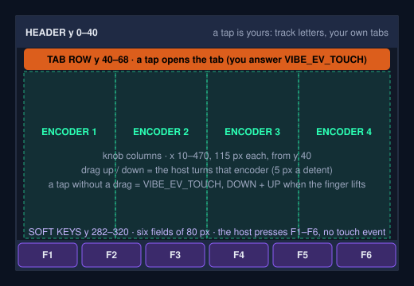

# Touch: one display, every host

Your Vibe's 480 × 320 display can be touched or clicked wherever it runs:

| Where | How |
|---|---|
| VIBE FM VST plugin, web player, emulator | the mouse: click, drag, wheel |
| VIBE Box | its touch screen |
| VIBE with an iPad | the VIBE's panel page (USB-C cable or Wi-Fi), a finger each |

It is the same event everywhere, and the same `.wasm`. This page says what the host does for you, what your Vibe should
answer itself, and how the knobs of a remote follow your values (SDK 29).

These are recommendations, as everything in [UI-GUIDE.md](UI-GUIDE.md): nothing here is required on the hub. But a
person with a finger on the screen expects them, and they cost a few lines.

**One rule stays above all: touch is the short way, never the only way.** Every function must stay reachable with the
keys and encoders.

## The zones



| Zone | Where | Who handles it | What you get |
|---|---|---|---|
| Soft keys | y 282–320, six fields of 80 px | the host | `VIBE_EV_BUTTON` F1–F6, held while touched |
| Knob columns | x 10–470, four of 115 px, from y 40 | the host, on a **drag** | `VIBE_EV_ENCODER` 1–4 (5 px = one detent) |
| A **tap** in a knob column | same area, no drag | you | `VIBE_EV_TOUCH` DOWN + UP, both when the finger lifts |
| Everything else | header (y < 40), the margins | you | `VIBE_EV_TOUCH` DOWN, MOVE, UP |

So if you draw the house layout (four values side by side, soft keys in the bottom strip), dragging a value and
pressing a soft key work with nothing written. A converted FM-1 firmware gets no touch at all.

The event:

```c
case VIBE_EV_TOUCH: {
    int x = VIBE_TOUCH_X(e), y = VIBE_TOUCH_Y(e);      /* display pixels, 0 / 0 top left */
    if (e->id == VIBE_TOUCH_DOWN) { /* ... */ }        /* also VIBE_TOUCH_MOVE, VIBE_TOUCH_UP */
    break; }
```

Several fingers can be down at once (pads and a drag together). The events carry no finger number, so treat each
DOWN as a tap of its own.

## What your Vibe should make tappable

People reach for the tabs first. Answer `VIBE_TOUCH_DOWN` for:

| What you draw | A tap should | Example |
|---|---|---|
| The **tab row** under the header (y 40–68) | open that tab | a colour key's sub-pages, a mixer's rows (LEVEL · FX · PAN …), a sequencer's views, the kinds in LOAD / SAVE |
| **Track letters** in the header | select the track | A–H |
| A **list row** | select it, as turning the knob there would | a track in a track list, a file, a pattern |
| A **step** in a grid | switch it on / off | a step sequencer |

Three things to get right:

- **Act on DOWN.** The tab row lies inside the knob columns. A tap there reaches you as DOWN and UP together when the
  finger lifts, so do not wait for a MOVE or measure a duration.
- **Compute the fields exactly as you draw them.** Put the geometry in one place (a function, or constants both the draw
  and the touch use). When the row changes, both change.
- **Do what the key would do.** Call the same function your K key or encoder calls, so the page, the lights and the
  captions stay right.

A complete, small example is [examples/hello](examples/hello/hello.c): two tabs, switched by K1 / K2 or by a tap.

```c
/* draw: the tab row, x 10-470, y 41-67 */
for (int i = 0; i < NTABS; i++) {
    int w = 466 / NTABS;
    vg_round(10 + i * w, 41, w - 6, 26, 5, i == tab ? ACCENT : CELL);
    vg_text(TAB_NAME[i], 10 + i * w + (w - 6) / 2, 46, VG_MED, i == tab ? 0x000000 : DIM, VG_CENTER);
}

/* event: the same fields */
if (e->type == VIBE_EV_TOUCH && e->id == VIBE_TOUCH_DOWN) {
    int x = VIBE_TOUCH_X(e), y = VIBE_TOUCH_Y(e);
    if (y >= 40 && y < 68 && x >= 10) { int i = (x - 10) / (466 / NTABS); if (i < NTABS) open_tab(i); }
}
```

## When your layout is not four columns: `"touch": "drag"`

Eight faders, bars that lie flat, an XY field, a waveform with markers: the host's four knob columns do not fit, and a
drag would turn the wrong encoder. Say so in your `firmware.json`:

```json
{ "name": "MY VIBE", "version": "1.0", "touch": "drag" }
```

Then there are no knob columns. Every drag is yours as DOWN, MOVE, UP; the soft keys stay the host's. In return you
handle your values yourself:

- A fader or bar follows the finger: on DOWN remember which one, on MOVE set its value from x or y, on UP let go.
- Keep the four values at the bottom draggable (up / down turns them), so the house habit still works.
- Taps as above: tabs, rows, steps, mute / solo.

ZP12 does this from 3.1 on (faders, FX bars, steps, START / END in the waveform).

## Tell the remote where your knobs stand: `vibe_led_ring`

The VIBE's iPad page draws the encoders beside the display. An endless knob has no position of its own, so say where
each one stands and the remote's knob and ring turn to it:

```c
/* in vibe_on_draw, every frame, for each encoder that has a value on this page */
vibe_led_ring(VE_1, cutoff / 127.0f, 0);          /* 0..1 */
vibe_led_ring(VE_2, (pan + 64) / 127.0f, 1);      /* bipolar: 0.5 is the middle */
```

- `value` is 0…1. `bipolar` 1 draws the ring from the middle (pan, detune, bend).
- Say it **every frame**. An encoder you do not name this frame turns free on the remote, which is right for a list or
  a page without that knob.
- The easiest place is where you draw the knob: one line in your `dial()`.
- A host without such knobs ignores it; an older firmware that never calls it works as before.

(The name is from SDK 1, when the device was planned with LED rings. It did nothing since; from SDK 29 it means this.)

## A push without a push button

On the iPad page a tap on a knob without turning is its push: encoders 1–4 send the extra buttons `VB_X1`–`VB_X1 + 3`,
DATA sends `VB_DATA_PUSH`. A firmware that does not take the extra buttons itself (`vibe_extras_own(1)`) gets pads 1–4
for them, as with the VIBE Box's encoders.

## Check list

- [ ] Four values side by side and soft keys in the bottom strip – or `"touch": "drag"` and your own drags.
- [ ] A tap on each tab of the tab row opens it.
- [ ] Track letters and list rows select what is tapped.
- [ ] Steps and switches toggle on a tap.
- [ ] Every one of these also works with keys and encoders.
- [ ] `vibe_led_ring` for each value shown, every frame.
- [ ] Tried with the mouse in the emulator: click every tab, drag every value.

## vibe-check tells you

`node tools/vibe-check.mjs build/my-vibe.wasm` taps eight places along the tab row and looks whether the display
answers, and whether your firmware says where its knobs stand. Both are hints (`·`), never a failure:

```
  ✓ Touch       a tap on the tab row (y 40-68) answers at 2 of 8 places
  ✓ Touch       says where 4 encoders stand (vibe_led_ring)
```

## Try it

```sh
sh tools/build.sh examples/hello
python3 tools/emulator.py          # then click the SINE / SQUARE tabs
```

Without a browser, `tools/wasmtest.mjs` sends a tap and saves the picture:

```json
{ "seconds": 1, "steps": [
  { "t": 0.2, "ev": [16, 0, 1, 25900] },
  { "t": 0.25, "ev": [16, 2, 0, 25900] },
  { "t": 0.5, "shot": "after-tap" } ] }
```

`ev` is `[type, id, down, value]`: type 16 = touch, id 0 DOWN / 1 MOVE / 2 UP, value = y × 512 + x (here x 300, y 50).
